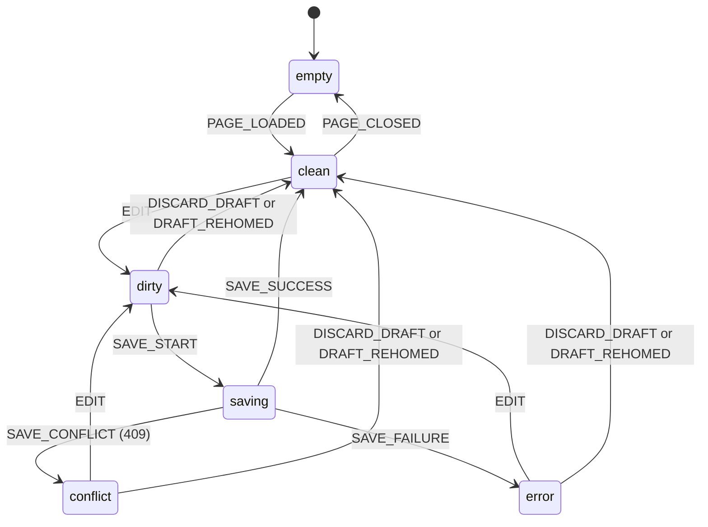
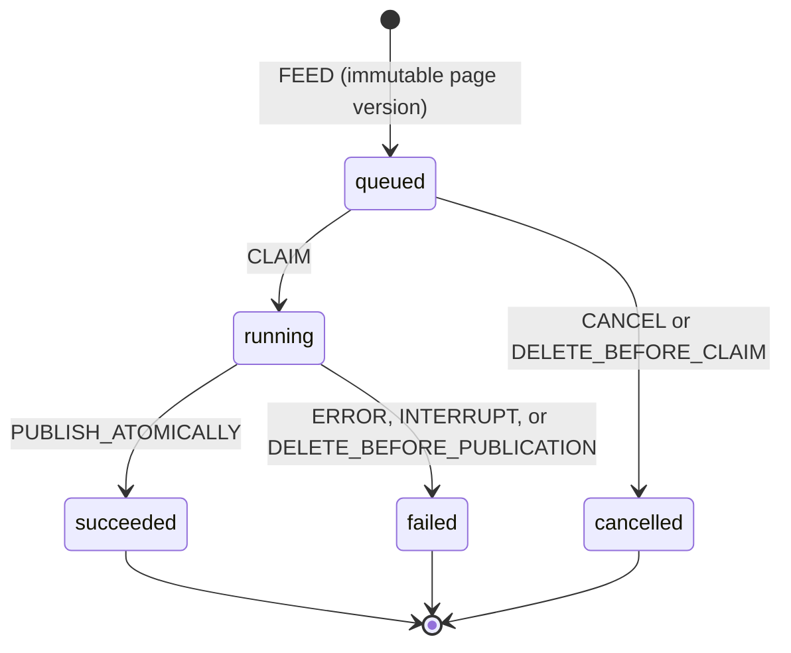

# TraceLLM v0.4 — explicit state machines and correctness boundaries

This document describes the **real** state transitions used by the local-only app.
A successful gradient update is not automatically evidence that the model learned
useful language. No extra training data, pretrained weights or telemetry are used.

## 1. Orthogonal UI state machines

The browser reducer (`static/ui_machine.js`) holds five independent dimensions:
`view`, `editor`, `operation`, `response`, and `connection`. Explicit transitions
are pure, immutable and tested under Node. No more duplicate mutable `dirty`,
`busy`, `visible` and `view` booleans in the UI controller.

- **Conflict does not destroy text.** The user can create a new page using the
  local textarea contents (server revision remains untouched), or explicitly
  confirm discarding them before loading the current server revision.
- No `PAGE_LOADED` or `PAGE_CLOSED` transition from a dirty/conflicting/error
  editor: a successful save or explicit resolved action is required first.
- A failed page load never replaces `state.page`, the response list or the
  editor text until both remote reads succeed. This avoids saving the old
  visible text into another page after a partial navigation failure.
- The `operation` machine rejects concurrent `OP_START` events and releases
  state via `finally`. It distinguishes save, generate, feed, navigation,
  deletion and restore. Responses are masked when a new page/response is loaded.
- The `connection` machine can become offline without altering the editor.
  A broken network cannot imply that content has been saved or trained.
- The browser state is presentation only; **SQLite is authoritative** for
  the training and checkpoint machines.

## 2. Durable job lifecycle

`lifecycle.py` contains the transition matrix and a SQLite compare-and-swap
helper. The durable `jobs.status` column is not mirrored by a second volatile
state store. Job transitions are legal only from the expected previous status.

To publish a checkpoint, in **one SQLite IMMEDIATE transaction** the engine
checks: (1) job status still `running`, (2) version's page is not deleted,
(3) `meta.current` equals the expected prior checkpoint. Only then can it
insert the checkpoint, finalize the job and update `meta.current`.

Checkpoint files are written via temporary file, fsync and atomic rename
before the database transaction. If the DB transaction rejects the candidate,
its orphan file is cleaned up; the public model remains the prior checkpoint.
This handles a race where deletion happens after the final training step but
before publication, and a DB error after the file rename.

## 3. Checkpoint lifecycle

The `checkpoint_state()` resolver returns `current`, `restorable`, `expired`,
or `unavailable` based on existing SQLite columns; no migration required.
The current checkpoint is never pruned solely due to age. Restoring a stored
model creates a new branch and leaves notebook pages and historical records
untouched. A soft-deleted page is excluded from future replay but its influence
is not magically removed from existing model weights.

## 4. Health and observability boundaries

- Running, queued, succeeded, failed and cancelled are **process states**.
- Training-page Loss is an **adaptation measurement**, not generalization.
- The first-seen pre-training Loss cannot establish independent validation
  without true untouched comparable text.
- Health summary consumes read-only SQLite metadata; missing or legacy fields
  are shown as missing, never invented as zero or a growth score.
- A failed health refresh labels displayed observations as stale.

## 5. Architecture choice

Three candidates were assessed: (A) just document flags without enforcing
transitions, (B) explicit domain guards and small browser reducer, (C) a
wholesale React/XState/backend rewrite. **B is adopted** because it removes
race and data-loss classes with no DB/checkpoint migration, retains CPU-first
training and local static serving, and keeps the desktop app dependency-light.
No Electron or frontend build-time runtime has been added.

## 6. Verification

- `python -m pytest -q` checks actual checkpoint publication, deletion race,
  idempotency, history compatibility, math, and local API behavior.
- `node --test tests/ui_machine.test.cjs` checks editor/operation/navigation /
  response-mask/connection state contracts and invalid transitions.
- `python tests/browser_state.py --browser chromium` uses a real Chromium DOM
  and a real FastAPI TestClient via a test-only bridge to reproduce revision
  conflicts, partial page fetch failures, safe draft recovery and deletion.
- `python tests/browser_smoke.py` and `tests/browser_health.py` are full HTTP
  browser tests. Local browser navigation may be blocked by container policy;
  GitHub Actions CI includes these on desktop OS runners. Test success on any
  OS is asserted only after that runner has executed the relevant job.

## Known limitations

This is not a strict OS-level CPU quota. Generation still uses a blocking
model lock during training. Account/authentication, remote hosting, complete
unlearning, guaranteed cross-platform deterministic weights, and proven
Japanese conversation quality remain out of scope. State machines make these
limitations explicit rather than concealing them behind UI labels.
